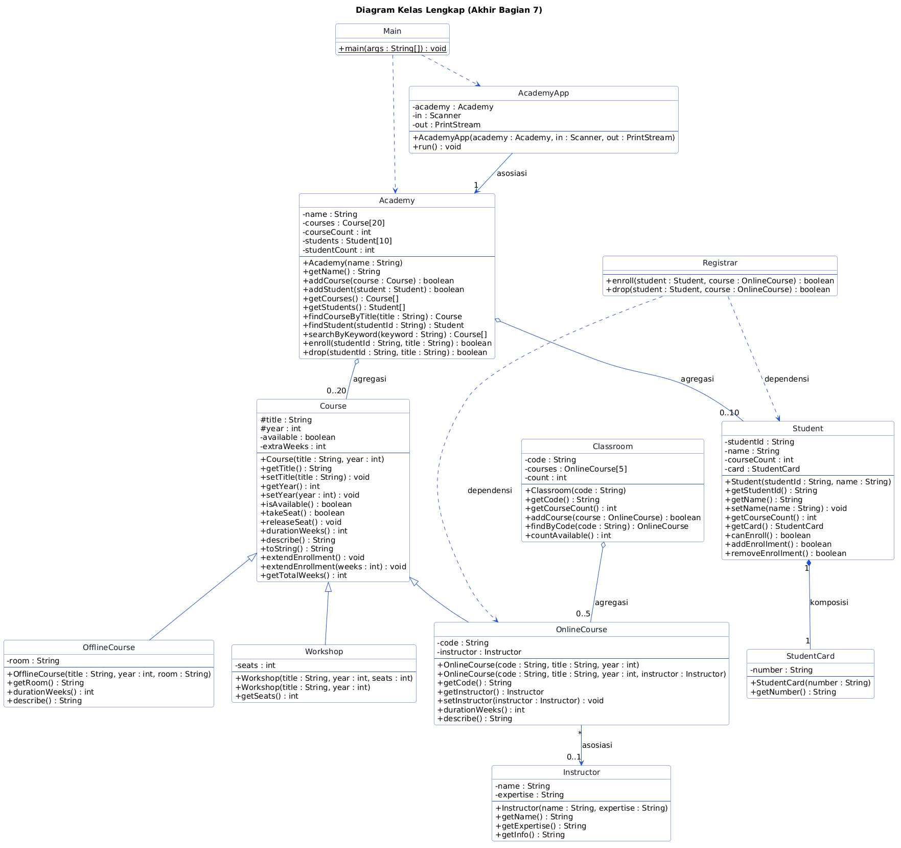
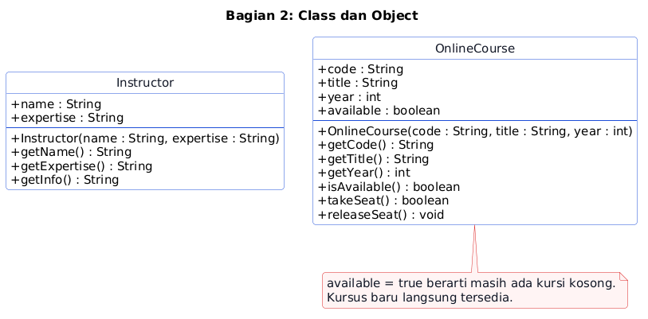
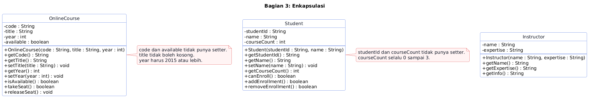
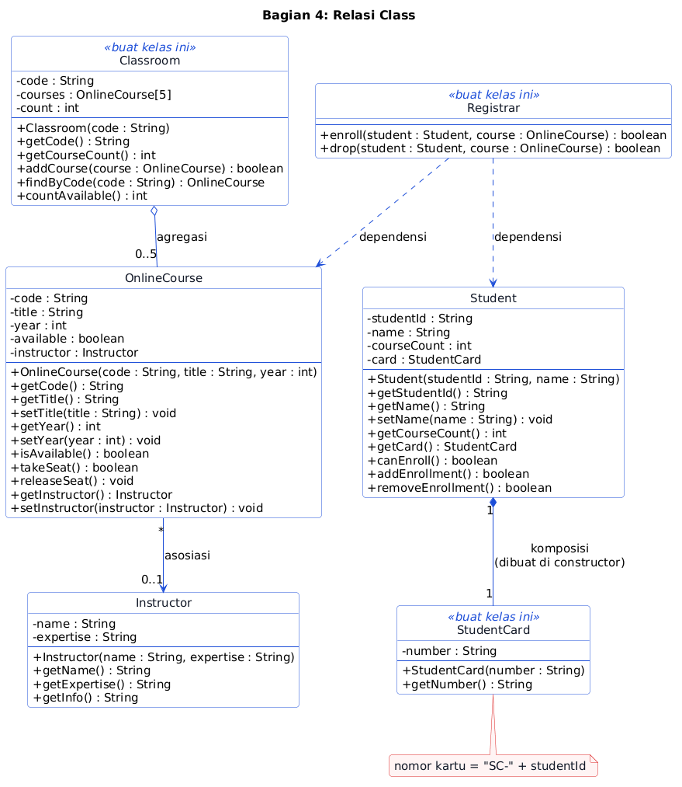
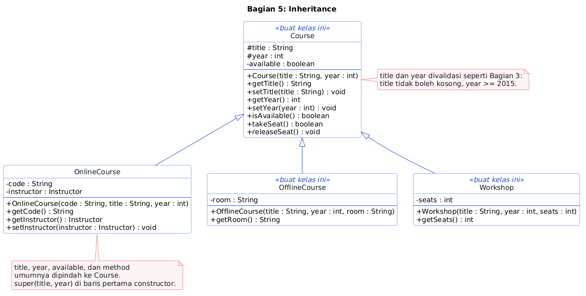
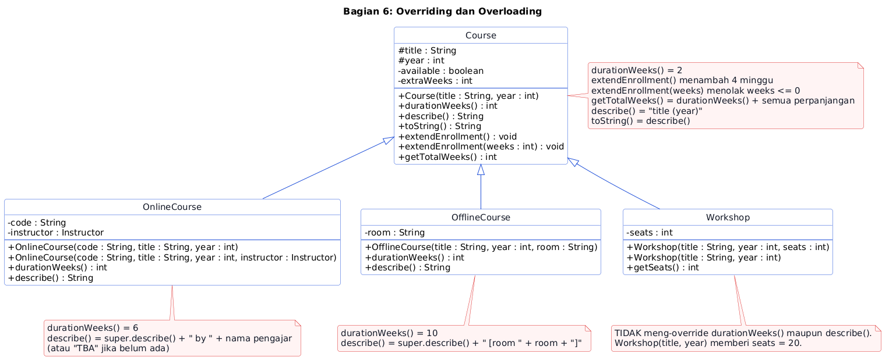
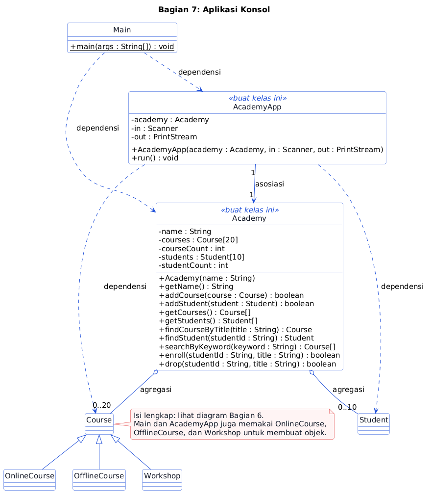

# UTS PBO Varian D: Pendaftaran Kursus

## Aturan

- Jangan ubah `src/test/**`, `.github/**`, dan `.wakatime-project`.
- Ikuti diagram persis: nama kelas, field, constructor, dan method.
- Buat semua field `private`, kecuali `title` dan `year` di `Course` (`protected`).
- Pakai array biasa. Jangan pakai `List` atau `ArrayList`.
- Jangan pakai `System.out.println` di `Academy` dan kelas model. Tampilan hanya di `Main` dan `AcademyApp`.
- Nyalakan WakaTime setiap kali mengerjakan (lihat Langkah 0).
- Kerjakan sendiri tanpa bantuan AI. Jangan memakai AI (chatbot, asisten kode, atau autocomplete berbasis AI) untuk menulis kode, menjawab soal, atau menyusun laporan. Kode, video, dan laporan harus hasil kerjamu, dan kamu menjelaskan kodemu langsung di video. Kode atau laporan salinan tidak dinilai.

## Langkah 0: Pasang WakaTime (wajib, sebelum menulis kode apa pun)

WakaTime mencatat waktu kamu mengetik kode. Dosen memakainya untuk menilai usaha.

1. Buat akun gratis di [wakatime.com](https://wakatime.com) dan salin API key dari [wakatime.com/settings/api-key](https://wakatime.com/settings/api-key). Jangan bagikan key ini.
2. Pasang plugin di editormu (NetBeans: `Tools > Plugins`; VS Code: ekstensi `WakaTime`; IntelliJ IDEA: `Settings > Plugins`), lalu tempel API key.
3. Ketik kode beberapa menit, lalu buka [wakatime.com/dashboard](https://wakatime.com/dashboard). Pastikan project **uts-d-kursus** muncul.

`.wakatime-project` berisi `uts-d-kursus`. Jangan ubah atau hapus. Waktu pengerjaan tanpa plugin tidak dihitung.

## Daftar Isi

1. [Aturan](#aturan)
2. [Langkah 0: Pasang WakaTime](#langkah-0-pasang-wakatime-wajib-sebelum-menulis-kode-apa-pun)
3. [Studi Kasus](#studi-kasus)
4. [Memulai](#memulai)
5. [Cara Membaca Diagram dan Bantuan](#cara-membaca-diagram-dan-bantuan)
6. [Bagian 1 sampai 7](#bagian-1-pengantar)
7. [Coba Aplikasinya](#coba-aplikasinya)
8. [Video Penjelasan](#video-penjelasan-wajib)
9. [Laporan Singkat (PDF)](#laporan-singkat-pdf-2-3-halaman)
10. [Pengumpulan](#pengumpulan)
11. [Penilaian](#penilaian)

## Studi Kasus

**Polinema Academy** menawarkan tiga jenis kursus:

- **Kursus online** (`OnlineCourse`): berlangsung 6 minggu, punya kode kursus dan pengajar.
- **Kursus tatap muka** (`OfflineCourse`): berlangsung 10 minggu, punya ruangan.
- **Workshop** (`Workshop`): berlangsung 2 minggu, punya jumlah kursi.

Setiap **mahasiswa** punya kartu mahasiswa dan boleh mengambil paling banyak **3** kursus. Satu kursus hanya punya satu kursi pada satu waktu: selama kursinya terisi oleh seorang mahasiswa, kursus itu tidak tersedia bagi mahasiswa lain. Petugas pendaftaran memakai aplikasi konsol untuk menambah kursus, mendaftarkan mahasiswa, mendaftarkan mahasiswa ke kursus, membatalkan, dan mencari kursus.

Aturan data: judul tidak boleh kosong dan tahun kursus minimal **2015**.

Gambaran seluruh kelas di akhir latihan ada di . Jangan langsung menyalinnya: kamu membangunnya bertahap, bagian demi bagian.

## Memulai

Pastikan WakaTime aktif.

1. Buka https://github.com/dhanifudin/oop-kursus, klik **Use this template**, lalu **Create a new repository**.
2. Pilih **Private**, lalu undang akun GitHub Dosen (`dhanifudin`) sebagai collaborator (**Settings > Collaborators**).
3. Clone repositori barumu, lalu commit dan push setiap selesai satu bagian.
4. Buka tab **Actions**. Autograder berjalan di setiap push dan menampilkan nilai kodemu.

Perintah yang dipakai (butuh JDK 17 atau lebih dan Maven):

```
mvn -q test                        # semua tes
mvn -q test -Dtest=P02OnlineCourseTest   # satu kelas tes
mvn -q compile exec:java           # jalankan Main
```

Baca pesan tes yang gagal. Pesannya menjelaskan apa yang kurang.

## Cara Membaca Diagram dan Bantuan

Diagram kelas adalah spesifikasi utama. Semua kelas, field, constructor, dan method yang kamu butuhkan ada di diagram.

| Simbol | Arti |
|---|---|
| `+` / `-` / `#` | `public` / `private` / `protected` |
| `nama : Tipe` | field atau parameter bernama `nama` bertipe `Tipe` |
| `metode() : Tipe` | method yang mengembalikan `Tipe` |
| `<<buat kelas ini>>` | kelas belum ada di starter, kamu yang membuatnya |
| `-->` | asosiasi |
| `o--` | agregasi (belah ketupat kosong) |
| `*--` | komposisi (belah ketupat penuh) |
| `..>` | dependensi |
| `<\|--` | inheritance (`extends`) |
| `0..5`, `1`, `*` | multiplicity (jumlah objek) |

Baca per kotak kelas: field di atas, constructor dan method di bawah. Lalu baca garis antar kelas.

Setiap bagian punya satu kotak **Bantuan**. Coba dulu sendiri, buka Bantuan hanya jika sudah buntu. Bantuan tidak berisi jawaban lengkap.

---

## Bagian 1: Pengantar

### Yang Diuji Oleh Autograder

- Baris **pertama** output `Main` adalah persis `Welcome to Polinema Academy`.
- Setelah baris itu, kamu bebas menambah baris lain.

### Pikirkan Dulu

- Apa yang dikerjakan compiler, dan apa yang dikerjakan JVM saat kamu menekan Run?
- Method mana yang pertama kali dijalankan Java, dan mengapa harus `static`?

<details>
<summary>Bantuan</summary>

- Perintah menampilkan teks berbentuk `System.out.println("teks kamu");`, ditulis di dalam kurung kurawal `main`.
- Huruf besar-kecil, spasi, dan ejaan di dalam tanda kutip harus persis sama dengan teks di atas.
- Kesalahan yang sering terjadi: `System` ditulis huruf kecil, tanda kutip tidak berpasangan, titik koma terlupa, atau kode ditulis di luar `main`.

</details>

### Periksa Hasil

Tes yang harus lulus: `P01MainOutputTest`.

---

## Bagian 2: Class dan Object



### Yang Diuji Oleh Autograder

- Constructor menyimpan semua parameternya, dan getter mengembalikan nilai yang sama.
- `Instructor.getInfo()` mengembalikan `nama (keahlian)`. Contoh: `Hendra Wijaya (Databases)`.
- Kursus yang baru dibuat **tersedia**.
- `takeSeat()` berhasil (`true`) satu kali. Selama kursi masih terisi, memanggilnya lagi menghasilkan `false`.
- `releaseSeat()` mengosongkan kursi sehingga kursus bisa diambil lagi.
- Dua objek `OnlineCourse` tidak saling memengaruhi.
- Di bagian ini field boleh `public` (seperti di diagram). Di Bagian 3 kamu akan menutupnya.

### Pikirkan Dulu

- Data apa saja yang perlu diingat setiap `OnlineCourse`? Mana yang berasal dari parameter, mana yang diatur sendiri oleh objek?
- Di constructor, nama parameter sama dengan nama field. Bagaimana Java membedakannya?
- Apa bedanya dua variabel yang menunjuk ke objek yang sama dengan dua variabel yang menunjuk ke dua objek berbeda?

<details>
<summary>Bantuan</summary>

- Field dideklarasikan di dalam kelas, di luar method. Tipenya bisa dibaca dari diagram. File `Instructor.java` dan `OnlineCourse.java` sudah berisi kerangka field di komentar atas kelas.
- Kata kunci `this` menunjuk ke objek yang sedang dikerjakan. Pakai `this.` di sisi kiri saat menyalin parameter ke field.
- Status "kursi terisi atau tidak" cocok disimpan sebagai `boolean`. Pikirkan nilai awalnya untuk kursus baru.
- `takeSeat()` punya dua jalur `return`: periksa dulu apakah kursi sudah terisi, baru ubah statusnya.
- Cara memeriksa tanpa tes: di `Main`, buat dua `OnlineCourse`, panggil `takeSeat()` dua kali pada yang pertama, lalu cetak `isAvailable()` kedua objek.

</details>

### Periksa Hasil

Tes yang harus lulus: `P02InstructorTest` dan `P02OnlineCourseTest`.

---

## Bagian 3: Enkapsulasi



### Yang Diuji Oleh Autograder

Semua kelas:

- Semua field `private`. Bandingkan diagram Bagian 3 dengan Bagian 2.

`OnlineCourse`:

- Judul `null`, kosong, atau hanya spasi **ditolak**. Tahun di bawah **2015** **ditolak** (2015 diterima).
- Penolakan berarti `IllegalArgumentException` dilempar dan nilai lama **tetap**.
- Constructor juga menolak data tidak valid. `code` tidak boleh kosong.
- `code` read-only (tanpa setter). Status tersedia tidak punya setter dan hanya berubah lewat `takeSeat()` dan `releaseSeat()`.

`Student` (kelas ini kamu isi dari stub sesuai diagram):

- `studentId` dan `courseCount` read-only (tanpa setter). `studentId` dan nama tidak boleh kosong.
- `setName` menolak nama kosong dan menjaga nama lama.
- Jumlah kursus selalu antara 0 dan 3. `addEnrollment()` dan `removeEnrollment()` mengembalikan `true` jika berhasil dan `false` jika sudah di batas.
- `canEnroll()` menjawab apakah mahasiswa masih boleh mengambil kursus.

### Pikirkan Dulu

- Jika `Student` punya `public int courseCount`, baris kode apa yang merusak aturan "maksimal 3"? Bagaimana `private` mencegahnya?
- Constructor dan setter punya aturan validasi yang sama. Bagaimana menghindari menulis aturannya dua kali?
- Apakah `canEnroll()` perlu field sendiri? Apa yang terjadi jika datanya tidak sinkron dengan `courseCount`?
- Mengapa `studentId` tidak boleh punya setter?

<details>
<summary>Bantuan</summary>

- Ubah modifier field menjadi `private`, lalu lihat apa yang error di `Main` kamu. Itu pelajaran enkapsulasinya.
- Urutan aman di setter: **periksa dulu**, baru isi field. Cek `null` lebih dulu sebelum memanggil method pada `String`. `String` punya method yang menjawab apakah teks kosong atau hanya spasi.
- Untuk menolak data, pakai `throw new IllegalArgumentException("pesan")`.
- Constructor boleh memanggil setter milik kelasnya sendiri.
- `canEnroll()` bisa dihitung langsung dari `courseCount` setiap kali dipanggil, dan `addEnrollment()` cukup bertanya pada `canEnroll()`.

</details>

### Periksa Hasil

Tes yang harus lulus: `P03EncapsulationTest` dan `P03StudentTest`.

---

## Bagian 4: Relasi Class



### Yang Diuji Oleh Autograder

`OnlineCourse` dan `Instructor` (asosiasi):

- Kursus baru belum punya pengajar. `getInstructor()` mengembalikan objek `Instructor` **yang sama** dengan yang diberikan ke `setInstructor`, dan dua kursus boleh berbagi satu `Instructor`.

`Student` dan `StudentCard` (komposisi):

- Setiap `Student` punya kartu dengan nomor berbentuk `SC-` diikuti `studentId`. Contoh: `SC-S101`.
- Kartu **tidak** diberikan dari luar. `Student` tidak punya constructor yang menerima `StudentCard`. Dua mahasiswa punya dua kartu berbeda.

`Classroom` (agregasi):

- Kapasitas kelas **5** kursus. `addCourse` mengembalikan `false` jika kelas penuh atau kursusnya `null`.
- `findByCode` mengembalikan objek `OnlineCourse` yang sama (bukan salinan), atau `null` jika tidak ada.
- `countAvailable` menghitung kursus yang saat ini tersedia.

`Registrar` (dependensi):

- Tidak punya field sama sekali.
- `enroll(student, course)` berhasil hanya jika mahasiswa boleh mengambil kursus **dan** kursus tersedia. Jika berhasil, kursi terisi dan jumlah kursus mahasiswa bertambah. Jika gagal, tidak ada yang berubah.
- `drop(student, course)` berhasil hanya jika kursi kursus sedang terisi dan mahasiswa punya kursus. Jika berhasil, kursus tersedia lagi dan jumlah kursus mahasiswa berkurang.

### Pikirkan Dulu

Jawab untuk **setiap** garis relasi di diagram:

- Siapa yang **membuat** objek di ujung garis: kelas ini sendiri, atau kode di luarnya?
- Jika pemilik objek dibuang, apakah objek di ujung garis ikut hilang?
- Apakah objek di ujung garis perlu disimpan sebagai **field**, atau cukup muncul sebagai **parameter** method?
- Apa arti `0..5` dan `0..1` pada garis tersebut?

<details>
<summary>Bantuan</summary>

- Asosiasi: simpan referensi sebagai field `private`, dengan getter dan setter. Jangan membuat objeknya di dalam kelas.
- Komposisi: objek dibuat dengan `new` **di dalam constructor** pemiliknya, dan tidak ada parameter constructor untuk objek itu.
- Agregasi: array `OnlineCourse[5]` plus satu penghitung isi (`count`). Telusuri array dari 0 sampai sebelum `count`, bukan sampai panjang array.
- Dependensi: tidak ada field. Objek hanya muncul sebagai parameter, dan `Registrar` memanggil method yang sudah ada di `Student` dan `OnlineCourse` (jangan menulis ulang aturan batas 3 kursus).
- Urutan di `enroll`: pastikan mahasiswa boleh mengambil kursus **sebelum** mengisi kursi, supaya kursus tidak berubah saat pendaftaran gagal.

</details>

### Periksa Hasil

Tes yang harus lulus: `P04AssociationTest`, `P04ClassroomAggregationTest`, `P04StudentCardCompositionTest`, dan `P04RegistrarDependencyTest`.

---

## Bagian 5: Inheritance



### Yang Diuji Oleh Autograder

- `OnlineCourse`, `OfflineCourse`, dan `Workshop` adalah subclass langsung dari `Course`.
- `Course` memvalidasi `title` dan `year` seperti `OnlineCourse` di Bagian 3. Field `title` dan `year` bersifat `protected`, dan tidak ada field `public`.
- `OnlineCourse` tidak lagi menyimpan `title`, `year`, dan status tersedia sendiri, dan tidak menulis ulang method yang sama dengan `Course`.
- `OfflineCourse` dan `Workshop` menyimpan data khususnya sesuai diagram (`private`). Getter judul dan tahun serta `takeSeat`/`releaseSeat` dipakai dari `Course`.
- Validasi setter ikut berlaku di semua subclass.
- Semua tes Bagian 2 sampai 4 masih lulus.

### Pikirkan Dulu

- Bandingkan `OnlineCourse` di diagram Bagian 4 dengan `OfflineCourse` di diagram Bagian 5. Apa yang **sama**? Apa yang **khusus**?
- Kalimat "`Workshop` adalah sebuah `Course`" masuk akal. Apakah "`Academy` adalah sebuah `Course`" juga masuk akal?
- Mengapa `title` dan `year` ditandai `#` dan bukan `-`?
- Jika `Course` punya constructor yang meminta `title` dan `year`, siapa yang harus mengisinya saat sebuah `Workshop` dibuat?

<details>
<summary>Bantuan</summary>

- Kata kunci `extends` menyatakan hubungan IS-A.
- Constructor tidak diwariskan. Subclass memanggil constructor parent dengan `super(...)`, dan harus menjadi **baris pertama**.
- Kerjakan bertahap: buat `Course`, pindahkan satu bagian dari `OnlineCourse`, jalankan tes, ulangi. Jangan memindahkan semuanya sekaligus.
- Jika tes lama merah setelah memindahkan sesuatu, sebuah method atau constructor kemungkinan hilang atau berubah.
- Ingat: `code` dan `instructor` tetap milik `OnlineCourse`, karena hanya kursus online yang punya keduanya.

</details>

### Periksa Hasil

Tes yang harus lulus: `P06InheritanceTest` (ditambah semua tes Bagian 2 sampai 4).

---

## Bagian 6: Overriding dan Overloading



### Yang Diuji Oleh Autograder

Method baru di `Course` (baca daftarnya di diagram):

- `durationWeeks()` mengembalikan **2**.
- `describe()` mengembalikan deskripsi singkat, dan `toString()` mengembalikan hasil yang sama dengan `describe()`.
- `extendEnrollment()` menambah perpanjangan **4** minggu. `extendEnrollment(int weeks)` menambah sebanyak `weeks`, dan menolak 0 atau negatif dengan `IllegalArgumentException`.
- `getTotalWeeks()` adalah durasi ditambah semua perpanjangan.

Nilai yang diharapkan:

| Objek | `durationWeeks()` | `describe()` |
|---|---|---|
| `Course("Generic", 2020)` | 2 | `Generic (2020)` |
| `OnlineCourse` tanpa pengajar | 6 | `Java Basics (2023) by TBA` |
| `OnlineCourse` dengan pengajar Dewi Lestari | 6 | `Java Basics (2023) by Dewi Lestari` |
| `OfflineCourse("Database Systems", 2021, "R-204")` | 10 | `Database Systems (2021) [room R-204]` |
| `Workshop("Git Bootcamp", 2024, 30)` | 2 | `Git Bootcamp (2024)` |

Constructor baru (lihat diagram):

- `OnlineCourse(code, title, year, instructor)` langsung mengisi pengajar.
- `Workshop(title, year)` memberi jumlah kursi **20**. Versi 3 parameter tetap berfungsi.

Struktur:

- `OnlineCourse` dan `OfflineCourse` meng-override `durationWeeks()`. `Workshop` **tidak** meng-override-nya.

### Pikirkan Dulu

- Bandingkan `describe()` milik `OnlineCourse` dan milik `Course`. Bagian mana yang sudah dikerjakan parent? Perlukah kamu menulisnya ulang?
- `Workshop` tidak perlu `durationWeeks()` sendiri. Mengapa? Versi siapa yang berjalan?
- `extendEnrollment()` dan `extendEnrollment(int)` sama-sama bernama `extendEnrollment`. Apa yang membedakannya bagi compiler? Bisakah salah satu memakai yang lain?
- Dua constructor `OnlineCourse` hampir sama. Bagaimana menghindari menyalin isinya?

<details>
<summary>Bantuan</summary>

- Override: tulis ulang method dengan signature yang sama di subclass, dan tambahkan `@Override` agar compiler membantu memeriksa.
- Untuk memakai versi parent di dalam override, panggil `super.namaMethod()`.
- Overload: nama sama, parameter berbeda. Satu versi boleh memanggil versi lain dengan nilai bawaan. Untuk constructor, gunakan `this(...)`.
- `getTotalWeeks()` memanggil `durationWeeks()`, jadi hasilnya mengikuti objek yang sebenarnya (polymorphism). Kamu butuh satu field private di `Course` untuk menyimpan total perpanjangan.
- `toString()` cukup mengembalikan `describe()`.

</details>

### Periksa Hasil

Tes yang harus lulus: `P07OverrideTest` dan `P07OverloadTest`.

---

## Bagian 7: Aplikasi Konsol



### Pikirkan Dulu

- `Academy` tidak boleh mencetak apa pun. Mengapa? Apa yang kamu ganti saat tampilannya menjadi GUI, dan apa yang tidak perlu disentuh?
- Array `courses` berisi `OnlineCourse`, `OfflineCourse`, dan `Workshop` sekaligus. Mengapa itu diizinkan? Konsep apa namanya?
- Mengapa `AcademyApp` menerima `Scanner` dan `PrintStream` lewat constructor, bukan langsung memakai `System.in` dan `System.out`?
- Pada alur "daftar kursus": objek mana yang dipanggil, dan method apa yang berjalan di masing-masingnya?

### Yang Diuji Oleh Autograder: kelas `Academy`

Buat kelas `Academy` sesuai diagram. Tidak boleh ada `System.out` di dalamnya.

| Method | Aturan |
|---|---|
| `addCourse` | `false` jika `null` atau array penuh (20 kursus). |
| `addStudent` | `false` jika `null`, penuh (10 mahasiswa), atau `studentId` sudah terdaftar. |
| `getCourses`, `getStudents` | Array baru yang **hanya berisi elemen terisi**. |
| `findCourseByTitle` | Judul dicocokkan **tanpa peduli huruf besar-kecil**. `null` jika tidak ada. |
| `findStudent` | Berdasarkan `studentId`. `null` jika tidak ada. |
| `searchByKeyword` | Semua kursus yang judulnya **memuat** kata kunci (tanpa peduli huruf besar-kecil). Jika tidak ada, kembalikan array **kosong**, bukan `null`. |
| `enroll(studentId, title)` | `true` hanya jika mahasiswa ada, kursus ada, mahasiswa boleh mengambil kursus, dan kursus tersedia. Setelah itu kursi terisi dan jumlah kursus mahasiswa bertambah. |
| `drop(studentId, title)` | `true` hanya jika mahasiswa dan kursus ada, kursi kursus sedang terisi, dan mahasiswa punya kursus. Setelah itu kursus tersedia lagi dan jumlah kursus mahasiswa berkurang. |

### Yang Diuji Oleh Autograder: `AcademyApp` dan `Main`

`Main` mencetak sapaan, membuat `Academy` bernama `Polinema Academy` berisi data contoh (minimal satu `OnlineCourse` dengan pengajar, satu `OfflineCourse`, satu `Workshop`, dan satu `Student`), lalu menjalankan `AcademyApp` dengan `new Scanner(System.in)` dan `System.out`. `AcademyApp` tidak punya `main` sendiri dan tidak memakai `System.in`/`System.out` langsung. Itu yang membuat autograder bisa "mengetik" menu untuk aplikasimu.

Tulis output **persis** seperti tabel. Cetak pesan dengan `println` dan prompt dengan `print` (tanpa pindah baris).

| Menu | Prompt (berurutan) | Hasil |
|---|---|---|
| (tiap putaran) | Judul `=== <nama academy> ===`, lalu baris `1. List courses`, `2. Add online course`, `3. Add offline course`, `4. Add workshop`, `5. Register student`, `6. Enroll student`, `7. Drop course`, `8. Search courses`, `9. List students`, `0. Exit`, lalu prompt `Select: ` | menu tampil lagi setelah setiap aksi |
| 1 List courses | tidak ada | Satu baris per kursus: `describe() \| status \| N weeks`. Status: `Open` (tersedia) atau `Full` (kursi terisi). N = `durationWeeks()`. Jika kosong: `No courses`. |
| 2 Add online course | `Code: `, `Title: `, `Year: `, `Instructor name (blank for none): `, lalu `Instructor expertise: ` hanya jika nama pengajar tidak kosong | `Course added`, atau `Academy is full` |
| 3 Add offline course | `Title: `, `Year: `, `Room: ` | `Course added`, atau `Academy is full` |
| 4 Add workshop | `Title: `, `Year: `, `Seats: ` | `Course added`, atau `Academy is full` |
| 5 Register student | `Student ID: `, `Name: ` | `Student registered`, atau `Student ID already exists` |
| 6 Enroll student | `Student ID: `, `Course title: ` | `Enrollment successful`, atau `Enrollment failed` |
| 7 Drop course | `Student ID: `, `Course title: ` | `Drop successful`, atau `Drop failed` |
| 8 Search courses | `Keyword: ` | Satu baris per hasil (format sama dengan menu 1). Jika tidak ada: `No courses found` |
| 9 List students | tidak ada | Satu baris per mahasiswa: `S101 - Rina (1 of 3 courses)`. Jika kosong: `No students` |
| 0 Exit | tidak ada | `Bye`, lalu program selesai |
| lainnya | tidak ada | `Invalid option` |

Aturan input untuk menu 2, 3, dan 4:

- `Year` harus bilangan bulat **2015 atau lebih**. `Seats` harus bilangan bulat positif. Jika tidak: cetak `Invalid number` dan batalkan penambahan.
- Jika `Code`, `Title`, atau `Room` kosong: cetak `Invalid input` dan batalkan.
- Untuk menu 5, jika `Student ID` atau `Name` kosong: cetak `Invalid input` dan batalkan.
- Kamu **tidak** perlu menangkap exception. Cek dulu inputnya, sehingga constructor tidak pernah menerima data tidak valid.
- Untuk menu 2: `Code`, `Title`, dan `Year` dibaca dulu. Data pengajar dibaca setelah ketiganya valid. Untuk menu 3 dan 4, semua prompt dibaca dulu baru diperiksa.

Contoh baris menu 1: `Java Basics (2023) by Dewi Lestari | Open | 6 weeks`.

<details>
<summary>Bantuan</summary>

- **`Academy`**: dua array (`courses` ukuran 20 dan `students` ukuran 10) masing-masing dengan penghitung isi, seperti di `Classroom`. Tipe elemen array kursus adalah `Course`, itu sebabnya ketiga jenis kursus bisa masuk bersama. `java.util.Arrays.copyOf` berguna untuk memotong array menjadi bagian yang terisi (memakainya pada array biasa tetap sesuai aturan). `String` punya method perbandingan tanpa peduli huruf besar-kecil. `enroll` dan `drop` cukup memanggil method yang sudah ada di `Student` dan `Course`: cari, periksa, ubah. Perhatikan urutannya agar kursus tidak berubah saat pendaftaran gagal.
- **`AcademyApp`**: kerjakan satu method sekali, mulai dari yang paling sederhana (`showCourses`, lalu `enrollStudent` dan `dropCourse`, lalu `showStudents`, `registerStudent`, dan terakhir tiga method penambah kursus). Jalankan `P08AcademyAppTest` setelah beberapa method selesai.
- Semua handler berpola sama: **baca input**, **periksa**, **serahkan ke `academy`**, lalu **cetak hasil**. `AcademyApp` tidak memutuskan boleh atau tidaknya mendaftar. Keputusan itu milik `Academy`.
- Bentuk dasar yang perlu ada: method `run` (menu, baca satu baris, `switch`, ulangi sampai pilihan `0` atau input habis), `readLine`, dan `readInt` (kembalikan -1 untuk input yang bukan bilangan positif). Gunakan `in` dan `out`, bukan `System.in` dan `System.out`.
- Baris kursus dipakai oleh menu 1 dan 8: tulis sekali di satu method bantu, panggil dua kali.
- Pesan di layar harus persis seperti tabel. Perbedaan satu huruf membuat tes gagal.
- `Main`: cetak sapaan, buat `Academy`, tambahkan data contoh, buat `AcademyApp`, lalu panggil `run()`.

</details>

### Periksa Hasil

Tes yang harus lulus: `P08AcademyTest` dan `P08AcademyAppTest`. Setelah itu jalankan aplikasi dan coba semua menu.

---

## Coba Aplikasinya

Setelah `Main` selesai, jalankan:

```
mvn -q compile exec:java
```

Contoh sesi (data awal: kursus online `Java Basics`, kursus tatap muka `Database Systems`, workshop `Git Bootcamp`, mahasiswa `S101 - Rina`):

```
=== Polinema Academy ===
1. List courses
...
0. Exit
Select: 6
Student ID: S101
Course title: Java Basics
Enrollment successful
...
Select: 1
Java Basics (2023) by Dewi Lestari | Full | 6 weeks
Database Systems (2021) [room R-204] | Open | 10 weeks
Git Bootcamp (2024) | Open | 2 weeks
...
Select: 9
S101 - Rina (1 of 3 courses)
...
Select: 0
Bye
```

---

## Video Penjelasan (wajib)

Video adalah bukti bahwa kode ini milikmu dan kamu memahaminya. Nilainya sama besar dengan kode.

**Format**: minimal 10 menit, tanpa batas maksimal, **wajah dan layar** terlihat (webcam di pojok, layar penuh). Unggah ke YouTube dengan visibilitas **unlisted**. Tempel linknya di `video/LINK.md`, lalu commit dan push.

**Isi video**, berurutan:

1. **Pengantar**: sebut nama, NIM, nomor absen, dan varian (D, Pendaftaran Kursus).
2. **Telusuri diagram melawan kodemu**: tunjukkan di kodemu
   - enkapsulasi: field `private`, validasi di setter dan constructor, field read-only;
   - empat relasi kelas: asosiasi, agregasi, komposisi, dan dependensi. Bedakan **agregasi dan komposisi dengan menunjuk baris kodenya** (siapa yang membuat objek, dan siapa yang menyimpan);
   - inheritance (`Course` dan tiga subclass);
   - override dan overload: tunjuk contoh masing-masing di kodemu dan jelaskan bedanya.
3. **Demo langsung**: jalankan `mvn test` sampai hasilnya terlihat. Lalu jalankan aplikasi dan peragakan satu alur transaksi lengkap (tambah kursus, daftarkan mahasiswa, `Enroll`, cek status, `Drop`) dan **satu kasus gagal** (misalnya mengambil kursus keempat atau kursus yang kursinya penuh).
4. **Jawab 3 pertanyaan teori dari bank soal**, satu dari setiap kategori. Dosen mengumumkan bank soal. Nomor soal ditentukan nomor absen (1 sampai 28), bukan NIM:
   - Soal 1 (Konsep dan enkapsulasi), nomor 1 sampai 4 = (bagian bulat dari (nomor absen - 1) / 4) mod 4, lalu + 1.
   - Soal 2 (Relasi kelas), nomor 5 sampai 8 = ((nomor absen - 1) mod 4) + 5.
   - Soal 3 (Inheritance, override, overload), nomor 9 sampai 14 = ((nomor absen - 1) mod 6) + 9.
   - Contoh: nomor absen 28 memberi soal 3, 8, dan 12.
5. **Refleksi**: bagian mana yang paling sulit dan apa yang kamu pelajari.

Rubrik video (dari dosen) dibagikan terpisah oleh dosen. Baca rubrik itu sebelum merekam.

Tips: latih dulu satu kali, jelaskan dengan kata-katamu sendiri (jangan membaca README), dan pastikan suara dan tulisan kode terbaca jelas.

## Laporan Singkat (PDF, 2 sampai 3 halaman)

Serahkan satu file PDF: `laporan/Laporan_<NIM>_<Nama>.pdf`, contoh `laporan/Laporan_2441720001_Budi_Santoso.pdf`. Commit dan push ke repositori. Tulis dengan kata-katamu sendiri.

Isi laporan:

1. **Identitas**: nama, NIM, nomor absen, kelas, varian, link repositori GitHub, dan link video.
2. **Hasil pengujian**: screenshot `mvn test` atau tab Actions yang menampilkan nilai.
3. **Bukti WakaTime**: screenshot dashboard project `uts-d-kursus` (total waktu dan grafik per hari) dan total jam dalam teks.
4. **Refleksi**: konsep yang masih membingungkan dan rencana belajarmu.
5. **Pernyataan kejujuran**: tulis bahwa kode, video, dan laporan ini kamu kerjakan sendiri tanpa bantuan AI, forum, atau bantuan teman. Tanda tangani pernyataan bahwa kode dan video adalah hasil kerjamu sendiri.

## Pengumpulan

Kumpulkan **seluruh repositori**. Sebelum batas waktu, pastikan:

- [ ] WakaTime aktif selama kamu mengerjakan, dan project `uts-d-kursus` muncul di dashboard.
- [ ] Semua kode sudah di-push dan autograder di tab Actions sudah berjalan.
- [ ] `video/LINK.md` berisi link YouTube unlisted yang bisa dibuka dosen.
- [ ] `laporan/Laporan_<NIM>_<Nama>.pdf` ada, bernama benar, dan sudah di-push.
- [ ] Laporan memuat screenshot hasil tes, screenshot WakaTime, dan pernyataan kejujuran.
- [ ] `.wakatime-project` tidak berubah.

Kirim link repositori sesuai arahan Dosen.

## Penilaian

Polymorphism muncul sebagai konsep pengantar di studi kasus, tetapi tidak dinilai (tidak ada di tes, video, maupun bank soal).

| Komponen | Bobot |
|---|---|
| Kode (autograder) | 40% |
| Video penjelasan | 40% |
| Laporan | 10% |
| Usaha (WakaTime) | 10% |

Ketentuan:

- Jika video tidak ada, atau terbukti bukan kodemu (kamu tidak bisa menjelaskan kodemu sendiri), **nilai kode dikali 0,5**.
- Laporan atau kode salinan tidak dinilai.
- Keempat komponen wajib ada.

Rincian nilai kode (autograder, total 100 poin):

| Tes | Bagian | Poin |
|---|---|---|
| `P01MainOutputTest` | 1 | 5 |
| `P02InstructorTest` | 2 | 5 |
| `P02OnlineCourseTest` | 2 | 10 |
| `P03EncapsulationTest` | 3 | 10 |
| `P03StudentTest` | 3 | 10 |
| `P04AssociationTest` | 4 | 5 |
| `P04ClassroomAggregationTest` | 4 | 10 |
| `P04StudentCardCompositionTest` | 4 | 5 |
| `P04RegistrarDependencyTest` | 4 | 5 |
| `P06InheritanceTest` | 5 | 10 |
| `P07OverrideTest` | 6 | 10 |
| `P07OverloadTest` | 6 | 5 |
| `P08AcademyTest` | 7 | 5 |
| `P08AcademyAppTest` | 7 | 5 |
| **Total** | | **100** |

Satu kelas tes dinilai penuh hanya jika **semua** tesnya lulus.
